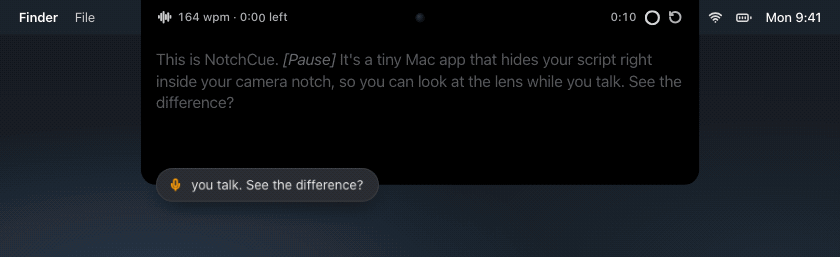

<div align="center">

# NotchCue

**The teleprompter that listens.**
Your script lives in your MacBook's notch, right beside the camera, and follows your voice word by word, completely offline.

[](#requirements)
[](https://swift.org)
[](LICENSE)
[](#privacy)

<!-- Replace with a screen recording of NotchCue following a read-through (see "Recording the demo" below). -->


</div>

---

## Why NotchCue?

Most "voice-activated" teleprompters only notice **that** you're talking. They scroll at a fixed speed while there's sound and stop when it's quiet, so you end up chasing the text or waiting for it.

NotchCue notices **what** you're saying. It transcribes your speech on your Mac and matches it against your script, so:

- 🎯 **It keeps your exact place**, highlighting what you've read.
- 🗣️ **It holds still when you ad-lib** and picks up again when you're back on script.
- ⏭️ **It catches up when you skip a sentence**, and goes back when you re-read one.
- ⏸️ **It waits when you pause.** No "scroll speed" to tune.
- 🔇 **It's invisible on screen**: hidden from Zoom, Google Meet, Chrome screen sharing, QuickTime and screenshots.

Your eyes stay next to the lens, so you look at your audience, not at a script.

## Features

| | |
|---|---|
| 🎙️ **Follows your voice** | Word-level tracking with on-device speech recognition, plus prediction that hides recognition lag |
| 🙈 **Hidden from capture** | Won't appear in screen shares or recordings (you can turn this off) |
| 🧠 **Script-aware vocabulary** | Names and jargon from your script are passed to the recognizer so it hears them correctly |
| ⏱️ **Pace and timer** | Live words per minute, time remaining, and an orange warning when you rush |
| 🎬 **Clean starts** | Optional 3-2-1 countdown, and an option to start only when you say your first words |
| ✋ **Manual mode** | Hold **⌃⌥⌘↓** or the **mouse wheel button** to scroll; let go to stop |
| 🎭 **Stage cues** | `[Pause]`, `[Smile]`: shown dimmed and italic, never waited for |
| 🔤 **Typography** | System, Serif, Rounded, Monospaced and **OpenDyslexic**, with weight, size, line spacing, letter spacing and alignment |
| 📍 **Anywhere** | In the notch, either top corner, or floating, on any display |
| 🌗 **Themes** | Dark or light panel, with a live preview while you adjust it |
| ⌨️ **Global shortcuts** | Work in every app, with no Accessibility permission needed |

## Privacy

NotchCue is **100% offline**.

- Speech recognition runs **on your Mac** with Apple's `SpeechAnalyzer`. Audio never leaves the device.
- Script matching is plain local code. **No AI services, no accounts, no analytics, no network calls.**
- The only download is Apple's one-time English speech model, which macOS fetches when you click **Download**.
- Your script is a plain text file in `~/Library/Application Support/NotchCue/`.

## Requirements

- A Mac with Apple Silicon, running **macOS 26 or later**. It works without a notch too: the prompter sits under the menu bar.
- **Xcode 26 or later** to build from source.

## Install

**[⬇ Download NotchCue for Mac](https://github.com/saadafaqk/notchcue/releases/latest)** (DMG; drag it into Applications).

This build isn't notarised yet, so on first launch macOS blocks it. Open **System Settings › Privacy & Security** and click **Open Anyway**. The [release notes](https://github.com/saadafaqk/notchcue/releases/latest) list checksums and a Terminal alternative.

### Build from source

```bash
git clone https://github.com/saadafaqk/notchcue.git
cd notchcue
Scripts/make-app.sh
open build/NotchCue.app
```

On first start, allow **Microphone** and **Speech Recognition** access. NotchCue lives in the menu bar, not the Dock.

## Usage

1. Click the NotchCue icon in the menu bar, then **Edit Script…**, and paste your script.
2. Press **⌃⌥⌘P**. The prompter grows out of the notch and counts down.
3. Start reading. That's it.

| Shortcut | Action |
|---|---|
| **⌃⌥⌘P** | Start or pause prompting |
| **⌃⌥⌘R** | Restart from the beginning (or click ↺ in the prompter) |
| **⌃⌥⌘H** | Show or hide the prompter |
| **hold ⌃⌥⌘↓** or **hold the mouse wheel button** | Scroll while held |

Tip: hovering over the prompter pauses it, and moving away resumes.

## How it works

```
Microphone ─▶ SpeechAnalyzer (on-device) ─▶ words ─▶ ScriptAligner ─▶ reading position ─▶ notch panel
                                                         ▲
                                     your script, normalised (numbers, punctuation, cues)
```

- **`CueCore`**: pure Swift logic with no UI or audio, covered by unit tests. It contains:
  - the script parser and text normaliser
  - a fuzzy, forward-biased **aligner** that tolerates misrecognitions, ignores ad-libs and detects skips and re-reads
  - the pace meter and the session state machine
- **`NotchCue`**: the macOS app. That's the AppKit panel, SwiftUI settings, the on-device speech source and global shortcuts.

Run the tests with:

```bash
swift test
```

## Roadmap

- [x] Downloadable DMG ([releases](https://github.com/saadafaqk/notchcue/releases))
- [ ] Signed, notarised releases and Homebrew cask
- [ ] Sections with time budgets (`## Intro (0:30)`), with ahead/behind indicators
- [ ] Missed-line report after each take
- [ ] Multiple scripts
- [ ] Cue actions (for example `[next slide]` advances Keynote)
- [ ] More languages

Have an idea? [Open an issue](https://github.com/saadafaqk/notchcue/issues).

## Contributing

Contributions are welcome.

- **Getting started:** read the design spec in [`docs/superpowers/specs`](docs/superpowers/specs), then run `swift test`.
- **Logic:** keep it in `CueCore` with tests.
- **App target:** keep it thin.
- **Pull requests:** please describe what you tested by hand, especially anything touching speech or the panel.

### Recording the demo

The prompter is hidden from screen capture by default. To record a README demo, turn off **Settings › Behavior › Hide from screen sharing and recordings**. Then record the top of the screen with QuickTime and convert it to `docs/media/demo.gif`.

## Credits

- [OpenDyslexic](https://opendyslexic.org) by Abbie Gonzalez, licensed under the SIL Open Font License 1.1.
- Inspired by the many notch prompters before it.

## License

[MIT](LICENSE) © Saad Afaq
